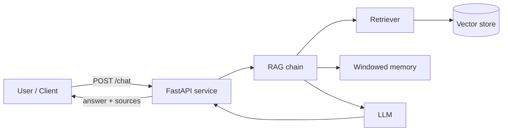

# langchain-rag-enterprise

Enterprise-grade Retrieval-Augmented Generation (RAG) service built on LangChain and FastAPI.

[](LICENSE)
[](https://github.com/abhisheksawant52/langchain-rag-enterprise/actions/workflows/ci.yml)
[](https://www.python.org/)
[](https://python.langchain.com/)
[](https://www.terraform.io/)

## Overview

`langchain-rag-enterprise` answers questions grounded in your organisation's own
documents. Documents are embedded and indexed in a vector store; at query time
the service retrieves the most relevant chunks, injects them into a prompt, and
asks an LLM to synthesise a grounded answer. A windowed conversation memory
gives the `/chat` endpoint short-term context across turns.

The application ships as a FastAPI service and includes a small but real
Terraform configuration that provisions the supporting cloud infrastructure, so
the project is deployable end to end.

## Architecture



Components:

- **FastAPI service** (`main.py`) — HTTP API with `/health`, `/ready`, `/chat`,
  `/query`, and `/ingest` endpoints on port `8000`.
- **RagChatService** (`service.py`) — orchestrates the chain and per-session
  memory.
- **RAG chain** (`chains.py`) — retriever → prompt → LLM → output parser.
- **Retriever** (`retrievers.py`) — similarity search over the vector store.
- **Vector store & embeddings** (`vectorstore.py`, `embeddings.py`) — provider
  abstractions (FAISS + OpenAI embeddings by default).
- **Memory** (`memory.py`) — windowed conversation buffer keeping the last *N*
  turns.

## Features

- Retrieval-augmented question answering grounded in your own documents.
- Stateless `/query` and stateful, memory-backed `/chat` endpoints.
- Document ingestion endpoint (`/ingest`) for embedding and indexing text.
- Pluggable embedding and vector-store providers.
- Environment-driven configuration via `pydantic-settings` (`LCRAG_*`).
- Production-ready packaging: multi-stage Docker image running as a non-root
  user with a container `HEALTHCHECK`.
- Infrastructure as Code with Terraform (ECR, CloudWatch, security group, and a
  vector-store module) and per-environment configuration.
- CI pipeline covering lint, tests (3.11 / 3.12), Terraform validation, and a
  Docker build.

## Tech Stack

Python 3.11+ · FastAPI · Uvicorn · Pydantic v2 · LangChain · LangChain OpenAI ·
FAISS · Terraform (AWS) · Docker · pytest · ruff · black · GitHub Actions

## Getting Started

### Prerequisites

- Python 3.11 or newer
- `make` (optional, for convenience targets)
- An OpenAI API key (for live embeddings and generation)

### Install

```bash
python -m venv .venv && source .venv/bin/activate
make install            # pip install -e ".[dev]"
```

### Configure

```bash
cp .env.example .env
# edit .env and set LCRAG_OPENAI_API_KEY
```

### Run

```bash
uvicorn langchain_rag.main:app --host 0.0.0.0 --port 8000
# then browse the interactive docs at http://localhost:8000/docs
```

Quick smoke test:

```bash
curl http://localhost:8000/health
curl -X POST http://localhost:8000/query \
  -H "content-type: application/json" \
  -d '{"question": "What is retrieval-augmented generation?"}'
```

## Project Structure

```
.
├── src/langchain_rag/          # application package
│   ├── main.py                 # FastAPI app factory + endpoints
│   ├── config.py               # pydantic-settings configuration
│   ├── service.py              # RagChatService orchestration
│   ├── chains.py               # RAG chain assembly
│   ├── retrievers.py           # vector-store retriever
│   ├── vectorstore.py          # vector store provider
│   ├── embeddings.py           # embedding provider
│   ├── memory.py               # windowed conversation memory
│   ├── models.py               # pydantic request/response models
│   └── logging_config.py       # logging setup
├── terraform/                  # infrastructure as code
│   ├── main.tf                 # ECR, log group, security group, module call
│   ├── modules/vector-store/   # vector store submodule
│   └── environments/           # per-environment tfvars (dev, prod)
├── tests/                      # pytest suite
├── docs/architecture.md        # architecture documentation
├── Dockerfile                  # multi-stage container image
└── .github/workflows/ci.yml    # CI pipeline
```

## Configuration

All settings use the `LCRAG_` environment-variable prefix (see `.env.example`).

| Variable                 | Default                    | Description                                   |
| ------------------------ | -------------------------- | --------------------------------------------- |
| `LCRAG_APP_NAME`         | `langchain-rag-enterprise` | Application name.                             |
| `LCRAG_ENVIRONMENT`      | `development`              | Deployment environment.                       |
| `LCRAG_LOG_LEVEL`        | `INFO`                     | Root logging level.                           |
| `LCRAG_OPENAI_API_KEY`   | _(unset)_                  | OpenAI API key (optional; no default secret). |
| `LCRAG_EMBEDDING_MODEL`  | `text-embedding-3-small`   | Embedding model identifier.                   |
| `LCRAG_LLM_MODEL`        | `gpt-4o-mini`              | Chat/completion model.                        |
| `LCRAG_VECTOR_STORE_URL` | `http://localhost:6333`    | Vector store connection URL.                  |
| `LCRAG_TOP_K`            | `4`                        | Documents retrieved per query.                |
| `LCRAG_TEMPERATURE`      | `0.0`                      | LLM sampling temperature.                     |
| `LCRAG_MEMORY_WINDOW`    | `5`                        | Conversation turns kept in memory.            |

## Deployment

### Docker

```bash
make docker-build       # docker build -t langchain-rag-enterprise:latest .
docker run --rm -p 8000:8000 --env-file .env langchain-rag-enterprise:latest
```

The image is multi-stage, runs as a non-root `appuser`, exposes port `8000`, and
declares a `HEALTHCHECK` against `/health`.

### Terraform

The [`terraform/`](terraform) directory provisions an ECR repository, a
CloudWatch log group, a security group, and a `vector-store` module.

```bash
cd terraform
terraform init
terraform plan  -var-file=environments/dev/terraform.tfvars
terraform apply -var-file=environments/dev/terraform.tfvars
```

Swap in `environments/prod/terraform.tfvars` for production. Copy
`terraform.tfvars.example` to `terraform.tfvars` for local overrides. Format and
validate with `make tf-fmt` and `make tf-validate`.

## Contributing

Contributions are welcome — see [CONTRIBUTING.md](CONTRIBUTING.md) and our
[Code of Conduct](CODE_OF_CONDUCT.md).

## Security

Please report vulnerabilities as described in [SECURITY.md](SECURITY.md).

## License

Released under the [MIT License](LICENSE).
