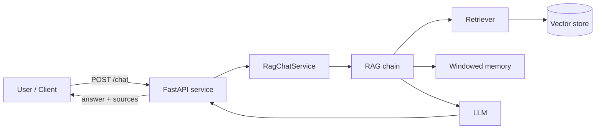

# Architecture

`langchain-rag-enterprise` is a Retrieval-Augmented Generation (RAG) service
built on [LangChain](https://python.langchain.com/) and served through
[FastAPI](https://fastapi.tiangolo.com/). It answers questions grounded in an
organisation's own documents while maintaining short-term conversational
context.

## Request flow

## Components

| Module | Responsibility |
| ------ | -------------- |
| `config.py` | Environment-driven settings (`LCRAG_*`) via pydantic-settings. |
| `main.py` | FastAPI app factory and HTTP endpoints (`/health`, `/ready`, `/chat`, `/query`, `/ingest`). |
| `service.py` | `RagChatService` orchestrating the chain and per-session memory. |
| `chains.py` | Assembles the retrieval-QA chain (retriever → prompt → LLM → parser). |
| `retrievers.py` | Configures a similarity-search retriever over the vector store. |
| `vectorstore.py` | Vector store provider abstraction (FAISS by default). |
| `embeddings.py` | Embedding provider abstraction (OpenAI embeddings). |
| `memory.py` | Windowed conversation buffer keeping the last *N* turns. |
| `models.py` | Pydantic request/response schemas. |
| `logging_config.py` | Structured logging configuration. |

## Data flow

1. **Ingestion** — `POST /ingest` embeds raw documents and indexes them in the
   vector store.
2. **Retrieval** — for each query the retriever performs a similarity search and
   returns the top-*k* chunks.
3. **Generation** — retrieved context is injected into the prompt and passed to
   the LLM, which synthesises a grounded answer.
4. **Memory** — `POST /chat` records each exchange in a windowed buffer keyed by
   `session_id`, giving the model short-term conversational context.

## Infrastructure

The [`terraform/`](../terraform) directory provisions the supporting cloud
infrastructure: an ECR repository for the container image, a CloudWatch log
group, a security group, and a `vector-store` module that stands up the managed
vector store instance. Per-environment values live under
`terraform/environments/`.

## Configuration

All configuration is supplied through `LCRAG_`-prefixed environment variables.
See [`.env.example`](../.env.example) and the README configuration table for the
complete list.
